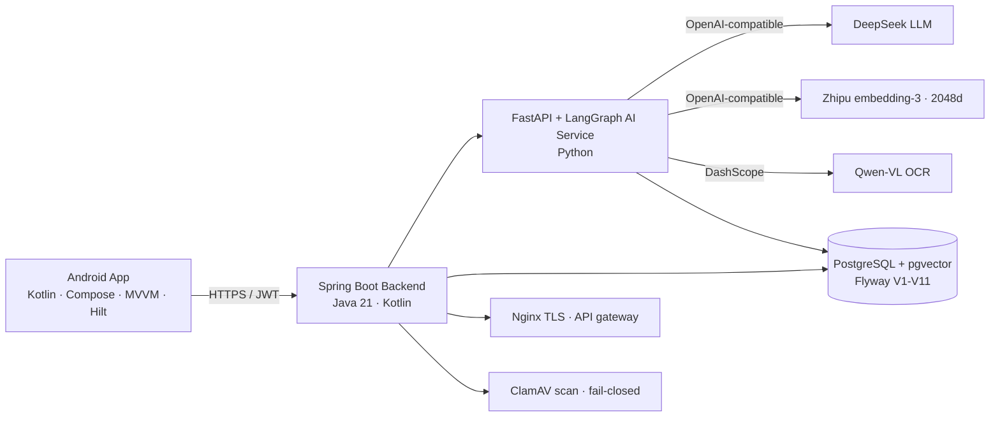

# Doctor-Wang · Personal Health Archive & AI Health Assistant

[](https://github.com/iPuuuuu/doctor-wang/actions/workflows/ci.yml)
[](./doctor-wang-mock-server)
[](./ai-service)
[](./app)
[](.)

A full-stack, production-deployed AI health assistant: upload medical reports (PDF / photos), get **evidence-grounded AI interpretation with citations**, chat with a **hypochondria/anxiety relief mode** ("安心话聊") that grounds every answer in the user's real health profile and reports — and honestly declines when there is no evidence.

> ⚠️ Health-assistance boundary: this app does NOT diagnose, prescribe, or replace emergency care. Every AI output carries a medical disclaimer and traceable citations. Emergency symptoms (chest pain, dyspnea, altered consciousness, severe bleeding) are triaged to emergency care.

## Why it stands out

- **Full product, not a demo**: Android app + Spring Boot backend + FastAPI/LangGraph AI service + PostgreSQL/pgvector + Docker Compose + GitHub Actions CI + **deployed on a production server** (TLS, monitoring, daily automated backups).
- **Medical-grade safety**: fail-closed pipeline, high-risk symptom triage, citation-traceable RAG, honest no-evidence fallback (zero fabrication — verified by evaluation).
- **Quantified RAG quality**: RAGAS-style evaluation harness (faithfulness / evidence coverage / relevance / decline correctness) with a DeepSeek LLM-judge over a 37-case Chinese medical QA set.
- **Hybrid retrieval**: char-bigram lexical channel + vector search fused with Reciprocal Rank Fusion (RRF), with before/after evaluation numbers.
- **Self-correcting agentic RAG (LangGraph)**: `generate → verify → backtrack` quality gate — a claim-level faithfulness judge flags unsupported statements and regenerates with a correction prompt; if unsupported claims remain, the answer is fail-closed to `needsReview`.

## Architecture



```
Android (Kotlin+Compose) ──HTTPS──▶ Spring Boot ──internal──▶ FastAPI/LangGraph AI Service
                                     │ PostgreSQL+pgvector          ├─ LLM: DeepSeek
                                     │ Flyway migrations            ├─ Embeddings: Zhipu embedding-3
                                     │ JWT + revocable sessions     ├─ OCR: Qwen-VL (DashScope)
                                     │ Hybrid retrieval:            └─ Symptom KB (curated, v1.0)
                                     │   char-bigram + vector + RRF
```

## Feature highlights

| Feature | Detail |
|---|---|
| Report upload + AI interpretation | PDF/JPG/PNG (≤20MB) → OCR → embedding → pgvector → LLM generates summary / key findings / suggestions **with citations** (structured `【摘要】【重点发现】【建议】` parsing, fail-closed fallback) |
| AI Q&A (general) | Answers grounded in the user's reports + health profile; high-risk terms routed to emergency care; **self-correcting generation** (LangGraph verify→backtrack) reduces hallucination |
| **Anxiety relief chat** (安心话聊) | Hypochondria/life-threatening-illness anxiety: distinguishes "what the report actually shows" from "what the user fears", empathetic + evidence-based, referral to psychology when needed. Enriched by a curated **symptom knowledge base** (benign explanations + red flags, non-diagnostic, versioned) |
| Health archive | History, biometrics, BMI overview |
| Auth & security | JWT (HS256) with **server-side revocable sessions**, BCrypt, per-user namespace isolation, no sensitive logging, file magic-number + MIME validation |

## Engineering quality

- **Tests**: backend 101 · AI 124 · Android 19 — all green locally and in CI.
- **CI (GitHub Actions)**: Android build, backend JDK 21 tests, **PostgreSQL/Testcontainers integration matrix**, AI pytest, whitespace gate.
- **RAG evaluation**: `ai-service/evaluation/` — 37-case medical QA set (evidence Q&A + no-evidence decline), RAGAS-style metrics via LLM-judge, `vector vs hybrid` comparison report (`docs/evaluation.md`).
- **Database**: Flyway V1–V11, pgvector columns, chat session separation, no destructive migrations.
- **Deployment**: Docker Compose, Nginx TLS, health-monitor cron, **daily automated backups** (PostgreSQL dump + report files, 7-day retention), one-command recovery script, end-to-end smoke test (`deploy/smoke-test.sh`, 10/10 on production).

## Repository layout

```
app/                        Android client (Kotlin · Compose · Material3 · MVVM · Hilt · Room · DataStore)
doctor-wang-mock-server/    Spring Boot 3 + Kotlin backend (Java 21 · JPA · Flyway · pgvector)
ai-service/                 FastAPI + LangGraph AI service (RAG · safety gates · evaluation harness)
deploy/                     Docker Compose, Nginx TLS, runbook, recovery/backup/smoke scripts
docs/                       Architecture, API reference, roadmap, domain guide, acceptance checklist
.ai/                        Engineering state, ADRs, task board
```

## Local development

```bash
# Android: unit tests + debug build
./gradlew :app:testDebugUnitTest :app:assembleDebug

# Backend (JDK 21): unit/contract tests
cd doctor-wang-mock-server && ./gradlew test

# AI service: tests + evaluation harness
cd ai-service && pip install -e ".[dev]" && pytest
python -m evaluation.run_evaluation --mode both   # needs real provider env (DW_AI_*)

# Production smoke test (any deployed instance)
bash deploy/smoke-test.sh [BASE_URL]
```

## Docs

- [Architecture & DB baseline](docs/design/doctor-wang-target-architecture.md)
- [API reference](docs/api-reference.md)
- [Deployment runbook](deploy/RUNBOOK.md)
- [Domain / ICP / release guide (中文)](docs/guide-domain-and-release.md)
- [User acceptance checklist (中文)](docs/user-acceptance-checklist.md)

## Status

Production-deployed and stable (2026-08). Remaining roadmap: real-device acceptance, domain + trusted certificate, release signing, ClamAV on upgraded hardware — see [Roadmap](docs/roadmap.md).
